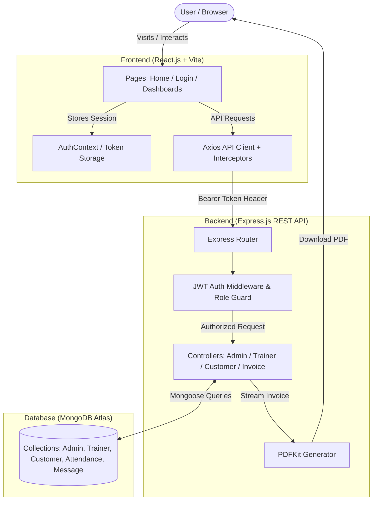

# fitS GYM - Master Full-Stack MERN Documentation

## 1. Quick Start & Run Commands

### Method A: From Root Directory (Recommended)

Open your terminal in `d:/dbms`:

```bash
# 1. Install all dependencies (first time only):
npm run install:all
```

---

### Method B: From Individual Sub-Folders

#### Backend Terminal:
```bash
cd backend
npm install
npm run dev
```

#### Frontend Terminal:
```bash
cd frontend
npm install
npm run dev
```

---


## 2. How to Generate a Secure JWT Secret

Run any of the following commands in your terminal to generate a cryptographically secure 64-byte JWT secret:

### Option C: Using OpenSSL (Git Bash / Linux / macOS)
```bash
openssl rand -hex 64
```

## 4. Technology Stack & Libraries

### Frontend
- **React.js (v18.3)**: Component-based reactive UI.
- **Vite (v6.0)**: Fast module bundler and dev server.
- **Tailwind CSS (v3.4)**: Utility-first CSS framework supporting Dark/Light modes.
- **React Router DOM (v6.28)**: Single Page Application routing and `<ProtectedRoute>` guards.
- **Lucide React**: Vector icons.
- **Canvas Confetti**: Visual celebration animations on payment completions.

### Backend
- **Node.js (v20+) & Express.js (v4.21)**: RESTful API server with asynchronous non-blocking I/O.
- **Mongoose (v8.9)**: Object Data Modeling (ODM) for MongoDB with schema validation.
- **JSON Web Token (jsonwebtoken)**: Stateless token authentication.
- **bcryptjs**: One-way salt password hashing.
- **PDFKit**: On-the-fly streaming PDF invoice generator.
- **CORS & Morgan**: Cross-origin resource sharing & HTTP request logging.

### Database
- **MongoDB**: NoSQL document database (Local instance or MongoDB Atlas Cloud).

---

## 5. Complete File & Folder Structure

```
d:/dbms/
├── .gitignore                   # Files and directories ignored by Git (e.g. node_modules, .env)
├── package.json                 # Root monorepo orchestration scripts (backend & frontend runner)
├── README.md                    # Single master documentation file
│
├── backend/                     # Node.js + Express.js API Server
│   ├── .env                     # Private environment variables (PORT, MONGODB_URI, JWT_SECRET)
│   ├── .env.example             # Public template for environment configuration
│   ├── package.json             # Backend dependencies and startup scripts
│   ├── reset-db.js              # Script to wipe database and recreate fresh default admin
│   ├── test-api.js              # Automated end-to-end REST API testing suite
│   └── src/
│       ├── server.js            # Express app entrypoint, middleware, and database listener
│       │
│       ├── config/              # Configuration constants & database connector
│       │   ├── constants.js     # Pricing tiers (Monthly, Quarterly, etc.) and diet plan enums
│       │   └── db.js            # Mongoose MongoDB connection logic with retry handlers
│       │
│       ├── models/              # Mongoose Schema Definitions
│       │   ├── Admin.js         # Admin credentials and password comparison method
│       │   ├── Trainer.js       # Coach details, specialization, salary, and salary_paid
│       │   ├── Customer.js      # Member details, macros, workouts, balances, and trainer reference
│       │   ├── Attendance.js    # Composite indexed attendance records for members and trainers
│       │   └── Message.js       # Real-time chat messages between coach and member
│       │
│       ├── middleware/          # Express Custom Middleware
│       │   ├── authMiddleware.js# Token extraction, verification, and role authorization guard
│       │   └── errorHandler.js  # Global centralized error and duplicate-key handler
│       │
│       ├── controllers/         # Business Logic Layer
│       │   ├── authController.js       # Admin, Trainer, and Member login handlers
│       │   ├── adminController.js      # Member/Trainer CRUD, payment recordings, stats
│       │   ├── trainerController.js    # Client management, meal/workout plan updates, chat
│       │   ├── customerController.js   # Dashboard metrics, self attendance check-in, chat
│       │   ├── attendanceController.js # Attendance aggregations & date-wise history
│       │   └── invoiceController.js    # Dynamic PDF invoice streaming using PDFKit
│       │
│       ├── routes/              # Express API Route Definitions
│       │   ├── authRoutes.js           # /api/auth/*
│       │   ├── adminRoutes.js          # /api/admin/*
│       │   ├── trainerRoutes.js        # /api/trainer/*
│       │   ├── customerRoutes.js       # /api/customer/*
│       │   ├── attendanceRoutes.js     # /api/attendance/*
│       │   └── invoiceRoutes.js        # /api/invoices/*
│       │
│       └── utils/
│           └── seed.js          # Auto-seeder guaranteeing default Admin exists on startup
│
└── frontend/                    # React.js Single Page Application (SPA)
    ├── index.html               # SPA HTML entry point with Google Fonts (Montserrat & Inter)
    ├── package.json             # Frontend dependencies & Vite build scripts
    ├── vite.config.js           # Vite dev server configuration and API proxy
    ├── tailwind.config.js       # Tailwind CSS theme extension, colors, and dark mode class
    ├── postcss.config.js        # PostCSS plugins for Tailwind and Autoprefixer
    └── src/
        ├── main.jsx             # React DOM root render
        ├── App.jsx              # React Router structure, route guards, and context wrappers
        ├── index.css            # Base Tailwind styles, custom scrollbars, and glassmorphism
        │
        ├── context/             # Global React State Contexts
        │   ├── AuthContext.jsx  # User authentication state, JWT storage, and logout
        │   └── ThemeContext.jsx # Dark/Light mode theme state management
        │
        ├── services/
        │   └── api.js           # Axios instance, Bearer token interceptor, and API endpoints
        │
        ├── components/          # Reusable UI Components
        │   ├── Navbar.jsx       # Responsive header with theme switch and dynamic role dashboard link
        │   ├── Footer.jsx       # Branded footer with contact and membership links
        │   ├── ProtectedRoute.jsx # Role-based route guard for authorized access
        │   ├── Modal.jsx        # Accessible dialog modal with keyboard Escape listeners
        │   └── StatsCard.jsx    # Metric overview cards with icons and color accents
        │
        └── pages/               # Application Views / Pages
            ├── Home.jsx         # Public landing page with Hero, About, Pricing, and Features
            ├── Login.jsx        # 3-in-1 Role login portal with quick demo buttons
            ├── admin/
            │   └── AdminDashboard.jsx  # Member CRUD, Trainer CRUD, Attendance, and Billing
            ├── trainer/
            │   └── TrainerDashboard.jsx # Assigned clients, diet/workout builder, and chat
            └── customer/
                └── CustomerDashboard.jsx # Attendance marker, macro tracker, chat, and invoice download
```

---

## 6. System Flow & Architecture Diagram



---

## 7. Database Schema & Models Design

### 1. `Admin` Collection
| Field | Type | Required | Description |
|---|---|---|---|
| `_id` | ObjectId | Auto | Primary Key |
| `username` | String | Yes | Unique login username (e.g. `admin`) |
| `password` | String | Yes | bcrypt hashed password |
| `createdAt` / `updatedAt` | Date | Auto | Timestamps |

### 2. `Trainer` Collection
| Field | Type | Required | Description |
|---|---|---|---|
| `_id` | ObjectId | Auto | Primary Key |
| `name` | String | Yes | Trainer's full name |
| `username` | String | Yes | Unique login handle |
| `password` | String | Yes | bcrypt hashed password |
| `phone` | String | No | Contact number |
| `specialization`| String | No | e.g. CrossFit, Powerlifting |
| `salary` | Number | No | Monthly salary (INR) |
| `salary_paid` | Number | No | Cumulative salary paid by gym |

### 3. `Customer` Collection
| Field | Type | Required | Description |
|---|---|---|---|
| `_id` | ObjectId | Auto | Primary Key |
| `name` | String | Yes | Member's full name |
| `phone` | String | Yes | Unique 10-digit mobile number (Login ID) |
| `password` | String | Yes | bcrypt hashed password |
| `membership` | String | Yes | `Monthly`, `Quarterly`, `Half-Yearly`, `Yearly` |
| `diet_plan` | String | Yes | `None`, `Standard`, `Weight Loss`, `Muscle Gain`, `Maintenance` |
| `amount_paid` | Number | Yes | Total membership fee paid |
| `amount_due` | Number | Yes | Calculated pending fee balance |
| `trainer_id` | ObjectId | No | Reference to `Trainer` collection |
| `calories` / `protein` / `carbs` / `fats` | Number | No | Daily nutritional target numbers |
| `meals` | String | No | Meal structure suggestions |
| `workout_plan` | String | No | Customized workout split text |

### 4. `Attendance` Collection
| Field | Type | Index | Description |
|---|---|---|---|
| `_id` | ObjectId | Auto | Primary Key |
| `userType` | String | Yes | `customer` or `trainer` |
| `customerId` | ObjectId | Yes (Composite) | Reference to `Customer` |
| `trainerId` | ObjectId | Yes (Composite) | Reference to `Trainer` |
| `attendance_date`| String | Yes (Composite) | Date string in `YYYY-MM-DD` |
| `status` | String | Yes | `present` or `absent` |

*(Unique index prevents duplicate attendance entries per user on the same date)*

### 5. `Message` Collection
| Field | Type | Required | Description |
|---|---|---|---|
| `_id` | ObjectId | Auto | Primary Key |
| `trainerId` | ObjectId | Yes | Reference to `Trainer` |
| `customerId` | ObjectId | Yes | Reference to `Customer` |
| `sender` | String | Yes | `customer` or `trainer` |
| `message` | String | Yes | Text content |
| `createdAt` | Date | Auto | Message timestamp |

---

## 8. Complete REST API Reference

| Method | Endpoint | Protection / Role | Purpose |
|---|---|---|---|
| `GET` | `/api/health` | Public | System health check |
| `POST` | `/api/auth/admin-login` | Public | Authenticates admin & returns JWT |
| `POST` | `/api/auth/trainer-login` | Public | Authenticates trainer & returns JWT |
| `POST` | `/api/auth/customer-login` | Public | Authenticates member by phone & returns JWT |
| `GET` | `/api/auth/me` | Protected (Any) | Returns current session profile |
| `GET` | `/api/admin/dashboard` | Admin | Fetches revenue stats, members, trainers |
| `POST` | `/api/admin/customers` | Admin | Registers new member & sets balance |
| `PUT` | `/api/admin/customers/:id` | Admin | Updates member details & assigned trainer |
| `DELETE` | `/api/admin/customers/:id` | Admin | Deletes member and their records |
| `POST` | `/api/admin/customers/:id/payment` | Admin / Member | Records fee payment towards due balance |
| `POST` | `/api/admin/trainers` | Admin | Adds new coach/trainer |
| `PUT` | `/api/admin/trainers/:id` | Admin | Updates coach details or salary |
| `DELETE` | `/api/admin/trainers/:id` | Admin | Deletes coach & unassigns from members |
| `GET` | `/api/trainer/dashboard` | Trainer | Gets assigned clients list and profile |
| `PUT` | `/api/trainer/customers/:cid/plans` | Trainer | Updates client diet macros & workout split |
| `GET` | `/api/trainer/messages/:cid` | Trainer | Retrieves chat history with client |
| `POST` | `/api/trainer/messages/:cid` | Trainer | Sends message to client |
| `GET` | `/api/customer/dashboard` | Customer | Gets member overview, macros, and invoice |
| `POST` | `/api/customer/mark-attendance`| Customer | 1-tap daily self attendance check-in |
| `POST` | `/api/customer/send-message` | Customer | Sends message to assigned coach |
| `GET` | `/api/attendance/customers` | Admin | Member attendance summary aggregation |
| `GET` | `/api/invoices/:cid` | Admin / Owner | Streams dynamic PDF invoice with PDFKit |

---

## 9. Zero-Setup Cloning & Auto Admin Seeding

When anyone forks or clones this project and inputs their own MongoDB URI:
1. The backend server startup checks `Admin.findOne({ username: 'admin' })`.
2. If no admin exists, `backend/src/utils/seed.js` **automatically initializes and hashes the default Admin account**.
3. **No manual SQL scripts or manual database setup needed!**

### Default Administrator Credentials:
- **Username**: `admin`
- **Password**: `admin`

---

## 10. Viva / Technical Interview Questions & Answers

### Q1: What is the MERN stack and why is it used here?
> **Answer**: MERN stands for **MongoDB, Express.js, React.js, and Node.js**. It creates a unified JavaScript environment across frontend and backend. React provides a dynamic SPA with client-side routing, Express and Node provide an asynchronous non-blocking REST API, and MongoDB stores JSON-like schema-validated documents for gym records.

### Q2: How does JWT authentication work in this application?
> **Answer**: Upon login, the server generates a signed JSON Web Token (JWT) containing the user ID and role (`admin`, `trainer`, or `customer`). The frontend stores this token and includes it in the `Authorization: Bearer <token>` header on subsequent requests. Express middleware (`protect` and `authorize`) verifies the token and enforces role-based access control.

### Q3: How are passwords secured in the database?
> **Answer**: Passwords are never stored in plain text. They are hashed using **`bcryptjs`** with 10 salt rounds (`bcrypt.hash(password, 10)`). During login, `bcrypt.compare()` compares the plaintext password against the stored hash.

### Q4: How is attendance duplicate-entry prevented?
> **Answer**: In `Attendance.js`, a composite unique index is set on `customerId + attendance_date` and `trainerId + attendance_date`. The controller also checks if attendance was already submitted for `today` and rejects duplicates.

### Q5: How is the PDF invoice generated without consuming disk space?
> **Answer**: Using **PDFKit**, the invoice is generated dynamically in memory and piped directly to the Express HTTP response stream (`doc.pipe(res)`) with `Content-Type: application/pdf`, allowing instant client download without saving temporary files to disk.
# gym-management-system
